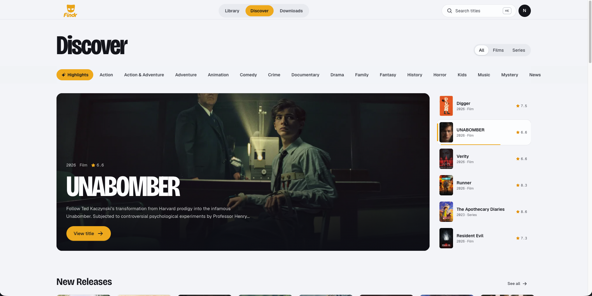
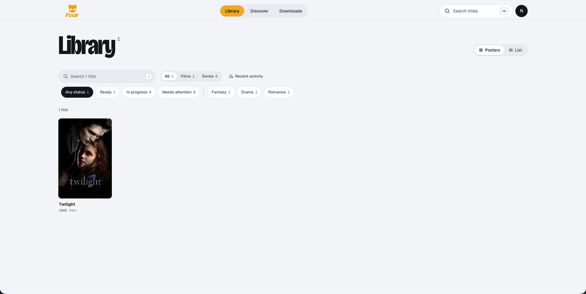
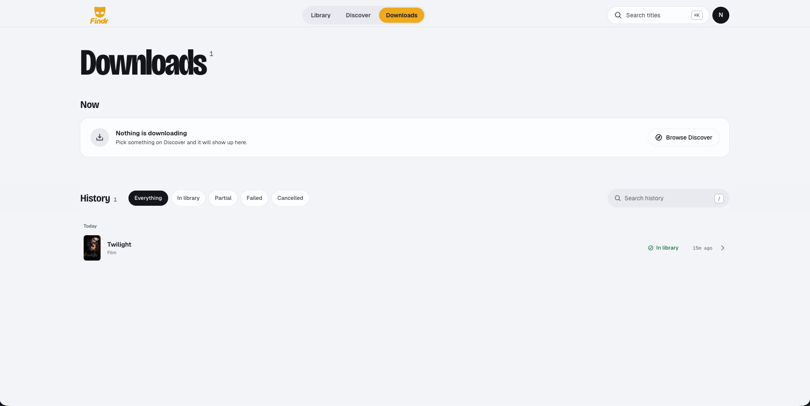

<div align="center">
  
  <h1>Find. Anything.</h1>
  <h4>Download any movie or TV show, ready for Plex or Jellyfin.</h4>
</div>

## What is Findr?

Findr is a self-hosted app for downloading movies and TV shows.

You search for a title, click **Download**, and Findr does the rest:

1. Searches your torrent indexers (through [Prowlarr](https://prowlarr.com/)).
2. Picks the best release for your quality preferences.
3. Downloads it with its own built-in torrent client.
4. Cleans the file down to just video and audio.
5. Names it and moves it into your library, ready for Plex or Jellyfin.

If a torrent is fake, dead, too slow or contains something dodgy, Findr throws it away and tries the next one by itself.

<table>
  <tr>
    <td></td>
    <td></td>
  </tr>
  <tr>
    <td colspan="2" align="center"></td>
  </tr>
</table>

## Features

- **One click** - search or browse movies and shows, then download a film or a whole season.
- **Picks the best release** - ranks every result by resolution, codec, HDR, source, size and seeders, and skips cams, wrong years and wrong seasons.
- **Built-in torrent client** - no qBittorrent or Transmission needed. Findr doesn't seed.
- **Safe files** - checks each torrent's file list before downloading and rejects executables, scripts and archives. Only the video files are downloaded.
- **Clean output** - every file is remuxed to video and audio only.
- **Full seasons** - grabs a season pack when there is one, otherwise downloads each episode separately.
- **Never stuck** - stalled or slow torrents are dropped and the next one is tried.
- **Watch in the browser** *(optional)* - play your library without a media server, with resume, continue watching, next episode and scrubbing thumbnails, and cast it to a TV with Chromecast, AirPlay or DLNA. Files are sent as they are when the device can play them, and converted when it can't, on the CPU or a hardware encoder. See [docs/Playback.md](docs/Playback.md).
- **VPN killswitch** *(optional)* - torrent traffic only goes through your VPN, and downloads pause if it drops. See [docs/VPN.md](docs/VPN.md).
- **Wrong-title filter** *(optional)* - uses Claude to weed out releases for a different movie or show.
- **Single binary** - one executable for Linux, macOS and Windows, or a Docker image.

## What you need

- **[Prowlarr](https://prowlarr.com/)** - to search your torrent indexers. There's a ready-made Docker setup in [`docker/`](docker/README.md).
- **[MKVToolNix](https://mkvtoolnix.download/)** (`mkvmerge`) - to clean the files.
- **[ffmpeg](https://ffmpeg.org/)** (`ffmpeg`, `ffprobe`) - optional, to watch your library in the browser. See [Playback](docs/Playback.md).
- **A [TMDB API key](https://developer.themoviedb.org/)** - free; used for titles, posters and episode lists.
- **An [Anthropic API key](https://console.anthropic.com/)** *(optional)* - only for the wrong-title filter.

## Install

### Binary

Download the file for your system from the [latest release](https://github.com/Benzo-Fury/Findr/releases) and run it:

```bash
chmod +x findr-linux-x64
./findr-linux-x64
```

On macOS, run `xattr -d com.apple.quarantine <file>` first.

Findr stores its data in a `data/` folder next to wherever you run it.

### Docker

The image `ghcr.io/benzo-fury/findr` comes with mkvmerge and ffmpeg included. Follow [running Findr in Docker](docker/README.md#running-findr-in-docker) for the Compose file and the first sign-in (which works a little differently in a container).

### From source

Needs [Bun](https://bun.sh) 1.4+.

```bash
git clone https://github.com/Benzo-Fury/Findr.git
cd Findr
bun install
bun run build
bun run start
```

## Setup

1. Open **http://localhost:34571** on the machine Findr runs on.
2. Sign in with `admin` / `admin`, then set your own email and password.
3. Go to **Settings → Services** and add your Prowlarr URL, Prowlarr API key and TMDB API key.
4. Go to **Settings → Library paths** and set where downloads, movies and TV shows go.
5. Want to use it from your phone or another computer? Turn on **Settings → Access → Allow access from other machines**.

That's it. Search for something and hit **Download**.

Everything else (naming, quality preferences, VPN, the torrent port, auto-updates) is in Settings. Every option is explained in [docs/Config.md](docs/Config.md).

**Locked out?** Stop Findr, delete `data/findr.db`, and start it again. You'll be back to `admin` / `admin` (and a fresh library list).

## Updates

Findr tells you when a new version is out. The binary can update itself in one click (or automatically, in Settings). Docker users pull the new image; source users pull and rebuild.

## Development

```bash
bun install
bun run dev                  # open http://localhost:34571
cd apps/api && bun test      # tests (some need mkvmerge and ffmpeg)
bun run build --target linux-x64   # cross-compile for another platform
```

## Legal

Findr is a tool. It doesn't host, index or distribute any content - it only downloads what you ask it to from the indexers you set up.

**Don't use Findr to break the law.** Downloading copyrighted material you don't have the rights to is illegal in many countries. You are responsible for what you download, and the developers accept no liability for how Findr is used.

## Credits

Inspired by [Roundup](https://github.com/0xlunar/roundup) by [0xlunar](https://github.com/0xlunar).

## License

Findr is licensed under the [Apache License 2.0](LICENSE).
